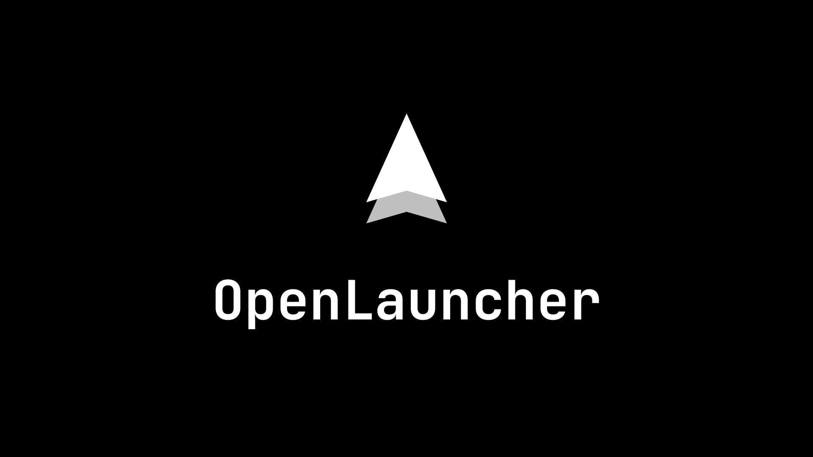
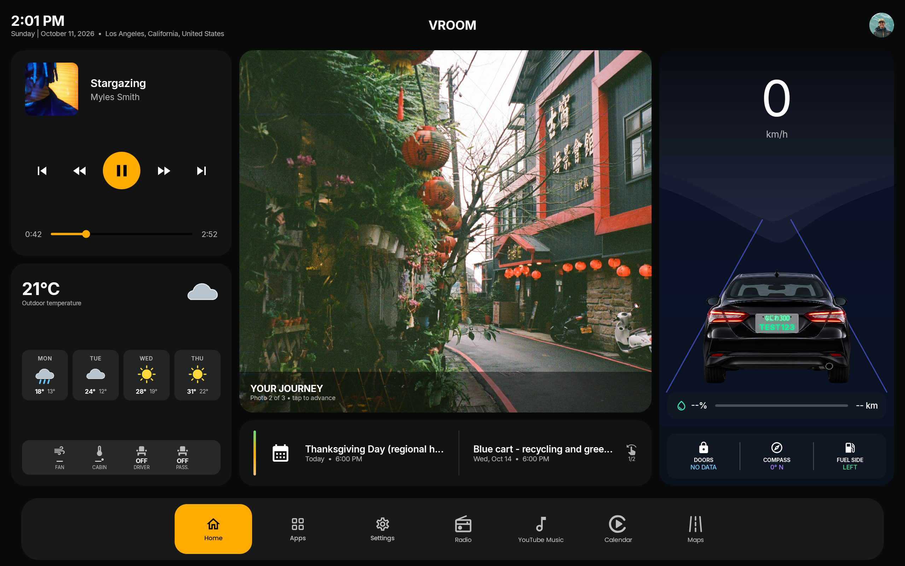
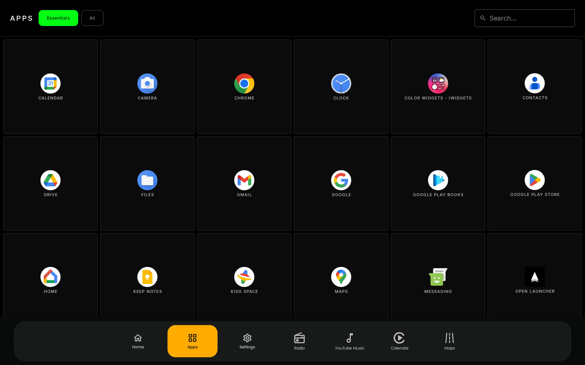
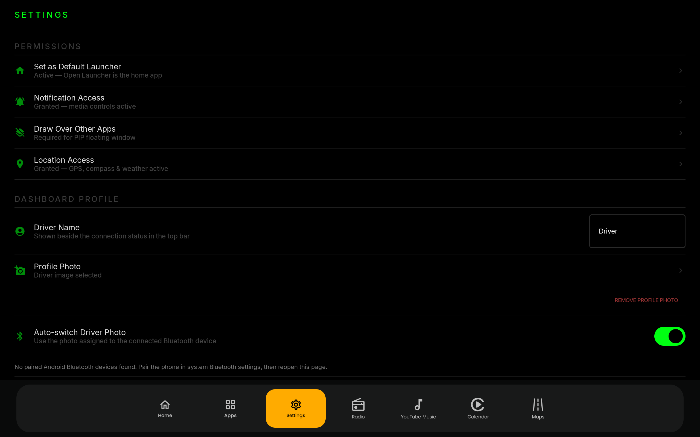

<div align="center">
  

  <p><strong>A landscape Android launcher designed for aftermarket car head units.</strong></p>

  [](https://github.com/pphan93/openlauncher/releases/latest)
  [](#compatibility)
  [](https://github.com/pphan93/openlauncher/actions/workflows/release.yml)
</div>

Open Launcher provides a clean, touch-friendly dashboard for Android head units. It combines media controls, weather, calendar events, vehicle information, an app library, and customizable shortcuts in one interface that remains useful when the head unit is offline.

> Open Launcher is under active development. Vehicle data and vendor-specific features depend on the head unit firmware and CAN-box integration.

## Screenshots

### Home



### App Library



### Settings



## Features

### Automotive dashboard

- Now Playing card with album art, transport controls, seeking, and MediaSession integration.
- Current weather and multi-day forecast using GPS or a manually selected fallback location.
- Photo carousel with user-selected dashboard images.
- Upcoming calendar events with swipe navigation when more events are available.
- GPS speed, compass heading, fuel range, fuel level, door status, and fuel-door side display.
- Custom vehicle name, driver profile photo, and regional license-plate styles.
- Metric and imperial units.

### Apps and navigation

- Searchable six-column app library with Essentials and All Apps views.
- Includes launchable apps and vendor/system apps that many launchers hide.
- Configurable navigation bar with custom app assignments and icons.
- Bottom or left-side navigation placement with adjustable size.
- Dedicated CarPlay, Android Auto, and radio app assignments. Open Launcher launches your existing receiver apps; it does not provide those services itself.

### Personalization

- Dark, light, system, and automatic sunrise/sunset display modes.
- Accent, dashboard accent, background, text, and license-plate text colors.
- Solid, linear, diagonal, and radial backgrounds plus custom wallpaper and dimming.
- Adjustable widget opacity, UI scale, text scale, and font weight.
- Poppins, Inter, Manrope, Barlow, Oxanium, system, JetBrains Mono, and Source Code Pro fonts.
- Optional vehicle name in the center of the status bar.
- Bluetooth-linked driver photos for automatic profile switching.

### Updates

- Checks the public GitHub releases feed from the Settings screen.
- Downloads the release APK and opens Android's package installer after user confirmation.
- Tagged releases are built and signed automatically by GitHub Actions and include a SHA-256 checksum.

## Vehicle data and CAN bus

Open Launcher only shows vehicle values received from the head unit; missing data remains clearly marked as unavailable instead of being replaced with simulated values.

| Platform | Current support |
| --- | --- |
| NWD G5 / K2401 with RAISE CAN box | Experimental decoding for fuel level, remaining range, and door status from discovered NWD broadcasts and validated RAISE frames. |
| Choiceway / RaviRS-based units | Supports known EventCenter door, trip, fuel, and raw-CAN broadcasts when exposed by the firmware. |
| FYT / UIS7862 and other units | Standard launcher features should work, but these platforms are not the same as NWD. Vehicle data requires a compatible vendor broadcast format and is not guaranteed. |

CAN implementations vary by vehicle, CAN-box model, selected car profile, MCU, and firmware version. A working factory vehicle-information screen does not necessarily mean third-party apps can access the same data.

## Compatibility

- Android 5.0 (API 21) or newer.
- Landscape displays; the interface is optimized for wide head-unit screens.
- GPS is recommended for speed, compass, automatic weather location, and sunrise/sunset mode.
- Internet access is required for weather, location search, and update downloads. The launcher, app library, media controls, calendar, and settings otherwise operate locally.

## Installation

1. Download the APK and matching checksum from the [latest release](https://github.com/pphan93/openlauncher/releases/latest).
2. If desired, verify the APK against the published `.sha256` file.
3. Copy the APK to the head unit or download it directly there.
4. Allow installation from the browser or file manager when Android asks.
5. Install Open Launcher and select it as the default Home app.
6. Open Settings inside the launcher and grant only the optional access needed for the features you use.

Upgrading over an existing installation preserves settings when the APK is signed with the same release key. If Android reports a signature conflict, uninstalling the existing build will remove its saved settings.

## Permissions

| Access | Used for |
| --- | --- |
| Location | GPS speed, compass calibration support, weather location, and automatic day/night mode. |
| Notification access | Reading and controlling the active media session for Now Playing. |
| Calendar | Displaying upcoming events on the dashboard. |
| Nearby devices / Bluetooth | Matching a connected phone to a driver profile photo. |
| Photos and files | Selecting wallpapers, dashboard photos, and profile images. |
| Modify system settings | Dashboard brightness control. |
| Install unknown apps | Installing an APK downloaded through the in-app updater. |

## Privacy and network use

- No account, analytics SDK, advertising SDK, or telemetry service is included.
- Preferences and selected media are stored locally on the head unit.
- Weather requests are sent to [Open-Meteo](https://open-meteo.com/).
- Update checks and APK downloads connect to this repository's public GitHub releases.
- Calendar, media-session, Bluetooth, and installed-app information is processed locally.

## Building from source

Requirements:

- Android Studio or the Android SDK command-line tools.
- JDK 17 or newer.
- Android SDK matching the project's `compileSdk` configuration.

On Linux or macOS:

```bash
./gradlew assembleDebug
```

On Windows:

```powershell
.\gradlew.bat assembleDebug
```

The debug APK is generated at:

```text
app/build/outputs/apk/debug/app-debug.apk
```

Release signing is configured through the `ANDROID_KEYSTORE_PATH`, `ANDROID_KEYSTORE_PASSWORD`, `ANDROID_KEY_ALIAS`, and `ANDROID_KEY_PASSWORD` environment variables. See [the release workflow](.github/workflows/release.yml) for the automated build process.

## Contributing

Testing across different head units, vehicles, MCU versions, and CAN boxes is especially valuable.

- Report reproducible bugs through [GitHub Issues](https://github.com/pphan93/openlauncher/issues).
- Include the head-unit model, Android version, MCU/firmware version, CAN-box brand, selected vehicle profile, and relevant logs for CAN-related reports.
- Open a feature request before starting a large change.
- Keep pull requests focused and describe how the change was tested.

## Known limitations

- CAN-bus access is vendor-specific; there is no universal Android API for aftermarket head units.
- Some system apps may refuse to launch outside their original vendor launcher.
- Weather and update checks require an internet connection.
- Layouts are designed for landscape head units rather than phones or portrait displays.
